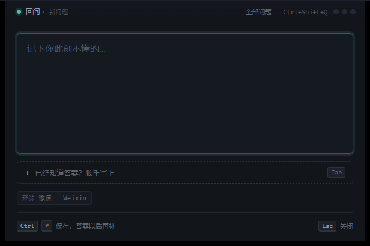

# 回问 Reask

按一个键把不懂的问题扔进去，找到答案后填回来，每天被自己的问题反问一遍。

Windows 桌面应用，Tauri + Rust 写的。纯本地，没有账号，没有云同步，数据就是一个 SQLite 文件。



## 它解决什么问题

你每天会遇到几十个「这个是怎么回事」的瞬间。当时查了、懂了、用上了，两周后再遇到，还是不懂。

这个工具做一件事：**把问题留下来，然后在你不抱期待的时候，突然问你一遍。**

记录 → 补答案 → 被考 → 翻旧账。四步闭环。

---

## 为什么是 Tauri

最早写的是 Electron 版，后来重写成 Tauri。同一台机器实测：

| | Electron 版 | 这个版本 |
|---|---|---|
| 安装体积 | 303.6 MB | **6.16 MB**（单 exe） |
| 私有内存 | 225.1 MB | 219.2 MB |
| 热键抓前台窗口 | 每次起 PowerShell，约 500 ms | 原生 Win32，<1 ms |
| 后端语言 | JavaScript | Rust |

体积小了 49 倍，热键快了两个数量级。**内存基本没变**——Windows 上 WebView2 本身就是完整
Chromium，省下的那点被它吃回去了。想省内存别指望换 Tauri，想省磁盘和热键延迟可以。

前端 100% 复用：`renderer/` 下的 HTML / CSS / JS 是原样搬过来的，
只加了一个 `renderer/api.js` 把 `window.api` 翻译成 Tauri 的 command + event。

---

## 运行

```bash
cd src-tauri
cargo run --release
```

已经编译好的直接用：

```
src-tauri\target\release\reask.exe
```

启动后打印一段横幅，然后终端停在那儿不动，这是正常的（托盘常驻程序）。

## 打包成安装包

```bash
cd src-tauri
cargo tauri build
```

需要先 `cargo install tauri-cli`。产物在 `src-tauri/target/release/bundle/`。

---

## 怎么用

| 动作 | 操作 |
|---|---|
| 记一个问题 | `Ctrl + Shift + Q` |
| 当时就知道答案 | 弹窗里按 `Tab` 展开答案栏 |
| 回填旧问题 | 再按热键，顶部挂「N 条问题还没填答案」 |
| 翻历史 | 记录窗右上角「全部问题」，或托盘右键 |
| 做今天的卷 | 到点弹通知，或托盘右键「开始今天的卷」 |

设置里可以改热键、出卷时间、大杂烩间隔、API Key。

---

## 数据

在 `%APPDATA%\com.reask.desktop\`

- `reask.db` —— 标准 SQLite 文件
- `settings.json`
- `backup\reask-YYYY-MM-DD.json` —— 每日自动备份

与最初的 Electron 版数据库结构完全一致，两边的 `.db` 可以互相拷。

---

## 结构

```
renderer/            前端（原生 HTML/CSS/JS，无框架）
renderer/api.js      唯一的一层胶水：window.api → Tauri invoke/event
src-tauri/src/
  main.rs            窗口、托盘、热键、定时、所有命令
  store.rs           SQLite（rusqlite）
  ai.rs              出题与判分，含离线降级
  rules.rs           日卷 / 大杂烩规则
  settings.rs        配置读写
  fg.rs              前台窗口标题（原生 Win32）
docs/prototype.html  设计原型（第一版 UI 稿）
```

---

## 开发笔记

几个踩过的坑，写下来省得下次再踩：

- **窗口不能用 `.visible(false)` 创建再 `show()`**。WebView2 不会初始化绘制，弹出来是一片黑，
  但 DOM 完全正常（`innerWidth`、`appH` 都是对的）。必须 `.visible(true)` 建完立刻 `.hide()`，
  首次显示再补一次 ±1px 尺寸微调强制重绘。
- **抓前台窗口必须在 `show()` 之前**，否则抓到的永远是回问自己。
- 调试黑屏先分清「DOM 有没有」和「画面有没有」：`api.js` 会在页面 load 时把
  `innerWidth / appH / 子节点数` 通过 `renderer_ready` 报给 Rust，终端里看 `[renderer] {...}`。

## 已知限制

- 只支持 Windows（前台窗口用 Win32 API）
- 内存和 Electron 版基本一样，切换的收益在体积和热键响应
- 窗口拖拽依赖 `data-tauri-drag-region`，由 `api.js` 在 DOMContentLoaded 时挂上
- 「输入文字 → Ctrl+Enter → 落库」这条路径还没做自动化测试，第一次用请确认数据库里有记录

